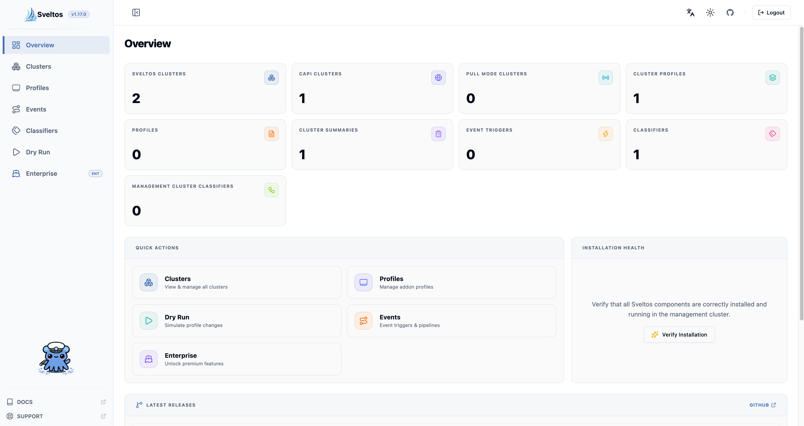

!!!video
    To learn more about the **Sveltos Dashboard**, check out the [Sveltos Dashboard](https://www.youtube.com/watch?v=L3bSYYvclJU) in action. If you find this valuable, we would be thrilled if you shared it! 😊



## Introduction to Sveltos Dashboard

The Sveltos Dashboard is not part of the generic Sveltos installation. It is a manifest file that will get deployed on top. If you have not installed Sveltos, check out the documentation [here](../install/install.md).

### Manifest Installation

To deploy the Sveltos Dashboard, run the below command using the `kubectl` utility.

```bash
$ kubectl apply -f https://raw.githubusercontent.com/projectsveltos/sveltos/main/manifest/dashboard-manifest.yaml
```

### Helm Installation

```bash
$ helm repo add projectsveltos https://projectsveltos.github.io/helm-charts

$ helm repo update
```

```bash
$ helm install sveltos-dashboard projectsveltos/sveltos-dashboard -n projectsveltos

$ helm list -n projectsveltos
```

!!! warning
    **_v0.38.4_** is the first Sveltos release that includes the dashboard and it is compatible with Kubernetes **_v1.28.0_** and higher.

To access the dashboard, expose the `dashboard` service in the `projectsveltos` namespace. The deployment, by default, is configured as a _ClusterIP_ service. To expose the service externally, we can edit it to either a _LoadBalancer_ service or use an Ingress/Gateway API.

## Authentication

The Sveltos Dashboard supports two authentication methods: **manual token authentication** (default) and **OIDC authentication**. The active method is determined at deploy time by the Helm values provided.

### Dashboard ClusterRoles

With both methods the dashboard acts as the logged in user: what a user sees, and what a user can change, is decided by the RBAC rules bound to that user. Sveltos ships two ClusterRoles, so there is no need to bind users to `cluster-admin`.

| ClusterRole | Grants |
|---|---|
| `sveltos-dashboard-viewer` | `get`, `list` and `watch` on every kind the dashboard reads: Cluster API `clusters`, SveltosClusters, ClusterProfiles, Profiles, ClusterSummaries, Classifiers, ManagementClusterClassifiers and EventTriggers. |
| `sveltos-dashboard-editor` | Everything in `sveltos-dashboard-viewer`, plus `create`, `update`, `patch` and `delete` on ClusterProfiles and Profiles, and `create`, `delete`, `get` and `update` on ConfigMaps. The dashboard stores the YAML of a profile in a ConfigMap. |

The roles are in the `config/user-rbac` directory of the [ui-backend](https://github.com/projectsveltos/ui-backend/tree/main/config/user-rbac) repository. Apply them to the management cluster:

```bash
$ kubectl apply -k "https://github.com/projectsveltos/ui-backend/config/user-rbac?ref=v1.17.0"
```

!!!note
    Neither role grants access to Secrets, and `sveltos-dashboard-viewer` grants no access to ConfigMaps. If a profile references a Secret, grant access to it with a namespaced `Role` in the namespace of the Secret: `get` and `update` to view and edit it from the dashboard, `delete` to remove it together with the profile.

!!!warning
    Write access to ClusterProfiles is effectively admin access to every cluster they select, because addon-controller deploys their content with its own privileges. The ConfigMap permissions of `sveltos-dashboard-editor` apply in every namespace. Bind `sveltos-dashboard-editor` only to users who are trusted with that.

### Manual Token Authentication

To authenticate with the Sveltos Dashboard, we will utilise a `serviceAccount`, a `ClusterRoleBinding`/`RoleBinding` and a `token`. Let's create a `service account` in the desired namespace.

```bash
$ kubectl create sa <user> -n <namespace>
```

The next step is to provide the service account permissions to access the **managed** clusters in the **management** cluster.

```bash
$ kubectl create clusterrolebinding <binding_name> --clusterrole <role_name> --serviceaccount <namespace>:<service_account>
```

| Argument         | Description                                                                                                                                            |
|------------------|--------------------------------------------------------------------------------------------------------------------------------------------------------|
| `binding_name`   | It is a descriptive name for the rolebinding.                                                                                                          |
| `role_name`      | It is one of the [Sveltos dashboard ClusterRoles](#dashboard-clusterroles) (or a custom cluster role) specifying permissions (i.e., which managed clusters this serviceAccount can see). |
| `namespace`      | It is the service account's namespace.                                                                                                                 |
| `service_account`| It is the service account that the permissions are being associated with.                                                                              |

#### Viewer Example

```bash
$ kubectl create sa dashboard-viewer
$ kubectl create clusterrolebinding dashboard-viewer-access --clusterrole sveltos-dashboard-viewer --serviceaccount default:dashboard-viewer
```

Create a login token for the service account with the name `dashboard-viewer` in the `default` namespace. The token will be valid for **24 hours**.

```bash
$ kubectl create token dashboard-viewer --duration=24h
```

Copy the token generated, login to the Sveltos Dashboard and submit it.

To also create and edit ClusterProfiles and Profiles from the dashboard, bind the service account to `sveltos-dashboard-editor` instead.

### OIDC Authentication

The dashboard supports OIDC authentication using the **Authorization Code Flow with PKCE** (public client). When enabled, the login page will show the OIDC login option instead of the manual token form.

Setting up OIDC requires **three steps**: configuring the dashboard, configuring the Kubernetes API server, and setting up RBAC for your dashboard users.

#### 1. Configure the Dashboard

OIDC is enabled by providing the following Helm values at install time.

| Helm Value | Description | Default |
|---|---|---|
| `auth.oidc.issuer` | Issuer URL of your OIDC provider | — |
| `auth.oidc.clientId` | Client ID registered with your OIDC provider | — |
| `auth.oidc.redirectUri` | Full redirect URI after OIDC login | `<origin>/oidc-callback` |
| `auth.oidc.scopes` | Scopes requested from the OIDC provider | `openid profile email offline_access` |
| `auth.oidc.tokenType` | Token of the login that the dashboard sends to the Kubernetes API server: `access_token` or `id_token` | `access_token` |

```bash
$ helm install sveltos-dashboard projectsveltos/sveltos-dashboard -n projectsveltos \
  --set auth.oidc.issuer=https://k8s-oidc-domain.example.com/auth/realms/k8s-oidc \
  --set auth.oidc.clientId=k8s-oidc-client \
  --set auth.oidc.redirectUri=https://dashboard.example.com/oidc-callback
```

Make sure that the client exists, it is configured as a **public client** (no client secret), and the redirect URI is registered in the OIDC provider. If the `auth.oidc.issuer` and the `auth.oidc.clientId` values are not set, the dashboard falls back to the manual token authentication.

---

##### Which token the dashboard sends

After the login, the OIDC provider returns an **access token** and an **ID token**. The dashboard sends one of them to the **Kubernetes API server** (or to the OIDC proxy in front of it), as set by `auth.oidc.tokenType`.

The default is `access_token`. Some providers need it, for example AKS with Microsoft Entra ID, where the access token must be issued for the AKS server application (set `auth.oidc.scopes` accordingly).

Set `auth.oidc.tokenType` to `id_token` when the provider issues access tokens that the Kubernetes API server cannot verify. The API server accepts only signed JWTs, and the ID token is always one. Typical cases:

- the access token is **encrypted** (a JWE, five segments separated by dots), as with NetIQ/SIAM;
- the access token is **opaque** (not a JWT);
- the access token is meant for the provider's own APIs, as for Okta when only the org authorization server is used.

The ID token is also the token that `kubectl` plugins such as `kubelogin` send, so it is the convention for Kubernetes.

!!!note
    `auth.oidc.tokenType` is available from the dashboard Helm chart version **1.16.1**. Older dashboard images ignore it.

!!!note
    The dashboard renews the token in the background, using the refresh token returned for the `offline_access` scope. With `id_token`, make sure the ID token lifetime configured in the provider is long enough for a working session, and that the provider returns a new ID token when the refresh token is used. Otherwise requests start failing with a 401 and the user has to sign in again.

#### 2. Configure the Kubernetes API Server

The **Kubernetes API server** must accept and validate the tokens of the OIDC provider. There are two ways to achieve it.

1. Configure the Kubernetes API server with the OIDC flags (if they can be changed)
1. Run an OIDC-aware proxy in front of the Kubernetes API server, such as `kube-oidc-proxy`, when the API server cannot be configured (for instance a managed control plane that does not expose the flags).

---

##### Option 1: OIDC flags Kubernetes API server

The required and optional flags are documented [here](https://kubernetes.io/docs/reference/access-authn-authz/authentication/#openid-connect-tokens).

The below is an example of configuring OIDC in a k3d cluster.

```bash
$ k3d cluster create oidc-test \
  --k3s-arg "--kube-apiserver-arg=oidc-issuer-url=https://k8s-oidc-domain.example.com/auth/realms/k8s-oidc@server:*" \
  --k3s-arg "--kube-apiserver-arg=oidc-client-id=k8s-oidc-client@server:*" \
  --k3s-arg "--kube-apiserver-arg=oidc-username-claim=preferred_username@server:*"
```

In this example, we use the `--oidc-username-claim` parameter to let the Kubernetes API server use the `preferred_username` claim from the OIDC token as the username.

---

##### Option 2: kube-oidc-proxy in front of Kubernetes API server

`kube-oidc-proxy` validates the OIDC token of the user. It then calls the real API server on behalf of the user using impersonation. The real API server needs no OIDC configuration.

Deploy `kube-oidc-proxy` in the **management** cluster, with the same **issuer** and **client ID** given to the dashboard. The below example uses the `kube-oidc-proxy` Helm chart _v1.8.1_ and the `email` claim as username.

```bash
$ helm install kube-oidc-proxy oci://ghcr.io/rafpe/charts/kube-oidc-proxy --version 1.8.1 \
  --namespace kube-oidc-proxy --create-namespace \
  --set tls.secretName=kube-oidc-proxy-tls \
  --set oidc.issuerUrl=https://k8s-oidc-domain.example.com/auth/realms/k8s-oidc \
  --set oidc.clientId=k8s-oidc-client \
  --set oidc.usernameClaim=email \
  --set tokenPassthrough.enabled=true \
  --set 'tokenPassthrough.audiences={https://kubernetes.default.svc.cluster.local}'
```

The Secret `kube-oidc-proxy-tls` holds the serving certificate of the proxy. Its DNS names must include the address the dashboard uses to reach the proxy, for instance `kube-oidc-proxy.kube-oidc-proxy.svc.cluster.local`.

Then point the Sveltos Dashboard backend (`ui-backend`) to the proxy. Only the requests made with the token of the dashboard user go to the proxy. The backend keeps using its own ServiceAccount to talk to the real API server, so do not change `KUBERNETES_SERVICE_HOST` for it.

First create a Secret with the CA that signed the certificate of the proxy, in the namespace of the dashboard.

```bash
$ kubectl create secret generic kube-oidc-proxy-ca -n projectsveltos --from-file=ca.crt=ca.crt
```

Then set the following Helm values to the dashboard chart.

```yaml
uiBackendManager:
  manager:
    extraArgs:
      oidc-proxy-host: https://kube-oidc-proxy.kube-oidc-proxy.svc.cluster.local:443
      oidc-proxy-ca-file: /etc/oidc-proxy-ca/ca.crt
    extraVolumes:
      - name: oidc-proxy-ca
        mountPath: /etc/oidc-proxy-ca
        readOnly: true
        secret:
          secretName: kube-oidc-proxy-ca
```

| Helm value | Description |
|---|---|
| `uiBackendManager.manager.extraArgs.oidc-proxy-host` | Address of the proxy (`scheme://host:port`). When not set, the backend talks directly to the API server. |
| `uiBackendManager.manager.extraArgs.oidc-proxy-ca-file` | CA bundle used to verify the serving certificate of the proxy. When empty, the system trust store is used. |
| `uiBackendManager.manager.extraVolumes` | Mounts the CA bundle into the backend pod. |

!!!warning
    When `oidc-proxy-host` is set, **every** token the dashboard receives goes to the proxy, including a ServiceAccount token pasted in the manual token login. The proxy only trusts tokens of its OIDC issuer, so without token passthrough that login fails with a 401. Enable `tokenPassthrough` on the proxy, as in the example above, with the audience of the ServiceAccount tokens of your cluster. Tokens the proxy cannot verify as OIDC tokens are then reviewed by the real API server.

Without token passthrough, only OIDC logins work through the proxy.

!!!note
    If the OIDC provider uses a certificate signed by a private CA, give that CA to the proxy as well, for instance with `--set-file oidc.caPEM=ca.crt` for the chart above. The proxy contacts the issuer to fetch the signing keys of the tokens.

#### 3. Configure RBAC for OIDC Users

The Kubernetes API server maps the username claim from the OIDC token to RBAC subjects. The subject name may include the issuer URL to avoid name clashes, based on the API server OIDC configuration. Refer to the [Kubernetes documentation](https://kubernetes.io/docs/reference/access-authn-authz/authentication/#openid-connect-tokens) for details on prefixing behaviour.

Bind the OIDC users, or the groups they belong to, to one of the [Sveltos dashboard ClusterRoles](#dashboard-clusterroles). The following example gives the OIDC user `test` read access to everything the dashboard shows. Use `sveltos-dashboard-editor` as the `roleRef` for users who also create and edit ClusterProfiles and Profiles:

```yaml
apiVersion: rbac.authorization.k8s.io/v1
kind: ClusterRoleBinding
metadata:
  name: k8s-oidc-dashboard-viewer
roleRef:
  apiGroup: rbac.authorization.k8s.io
  kind: ClusterRole
  name: sveltos-dashboard-viewer
subjects:
- apiGroup: rbac.authorization.k8s.io
  kind: User
  name: https://k8s-oidc-domain.example.com/auth/realms/k8s-oidc#test
```

Note that `subjects.name` includes the OIDC issuer URL prefix followed by the username claim value.

With `kube-oidc-proxy` (Option B) the same rules apply, because the proxy uses the Kubernetes OIDC authenticator. For instance, when the username claim is `email`, no prefix is added and the subject is the email address itself:

```yaml
subjects:
- apiGroup: rbac.authorization.k8s.io
  kind: User
  name: alice@example.com
```

!!!note
    Avoid binding dashboard users to `cluster-admin`. The dashboard roles above cover everything the dashboard needs.

#### 4. Logging In

Once all three steps are complete, the dashboard login page will display the OIDC login option. Clicking it redirects the user to the OIDC provider. After a successful sign-in, the provider redirects back to the configured redirect URI, and the user is taken to the dashboard.

#### Provider Notes

| Provider | Notes |
|---|---|
| NetIQ / SIAM | The access token is encrypted (a JWE). Set `auth.oidc.tokenType=id_token`. |
| Okta | With only the org authorization server, access tokens are meant for Okta's own APIs. Set `auth.oidc.tokenType=id_token`. A custom authorization server issues access tokens that are signed JWTs. |
| Microsoft Entra ID (AKS) | Keep `access_token`, and set `auth.oidc.scopes` to include the scope of the AKS server application. |
| Dex | Either token works. `id_token` is the Kubernetes convention. |
| Keycloak | By default the audience of the access token is not the client ID, which the API server checks. Use `id_token`, or add an audience mapper for the client. |

#### Troubleshooting a 401 Behind kube-oidc-proxy

If the backend cannot validate a token, it logs the reason and outlines the token that was sent. The token itself is never logged.

```
failed to validate token: the server has asked for the client to provide credentials.
Token (Kubernetes ServiceAccount token, issuer="https://kubernetes.default.svc.cluster.local"
audience=[https://kubernetes.default.svc.cluster.local] expires=2026-10-08T07:49:59Z (valid))
was sent to https://kube-oidc-proxy.kube-oidc-proxy.svc.cluster.local:443.
An OIDC proxy refuses ServiceAccount tokens unless token passthrough is enabled on it.
```

The above tells us the kind of token (a JWT, a Kubernetes ServiceAccount token or an opaque token), its issuer, audience and expiry, and where it was sent. Compare the issuer and the audience with the proxy's `oidc.issuerUrl` and `oidc.clientId`.

**Other Messages**

| Message | Meaning |
|---|---|
| `authorization header is missing` | The request had no `Authorization` header. |
| `authorization header is not a bearer token` | The header is present but is not of the form `Bearer <token>`. |
| `token is missing` | The header is `Bearer` with an empty token. |

The log of the proxy for the same request shows `auth_method: none` with `decision: deny`. This does **not** mean that no token was sent: the proxy logs it for any token it cannot authenticate. Some of the most common causes are listed below.

1. A ServiceAccount token was sent while token passthrough is off on the proxy. Enable `tokenPassthrough`.
1. The token is not one the proxy accepts: it is opaque or encrypted, or it has a different issuer or audience. Set `auth.oidc.tokenType=id_token`, and check the issuer and the client ID of the proxy.
1. The token is signed with a key the proxy does not hold. The proxy loads the signing keys of the issuer at startup, so after the provider restarts and rotates its keys (for instance Dex with in-memory storage), restart the proxy.
1. The token is malformed.

## Deployment Examples

An example of integrating the Sveltos dashboard with [Keycloak](https://www.keycloak.org/) using OIDC Authentication is available [here](https://blog.grosdouli.dev/blog/sveltos-dashboard-oidc-keycloak-cilium-gateway-api).